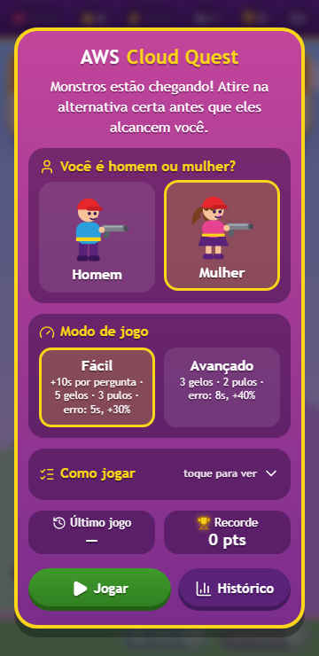
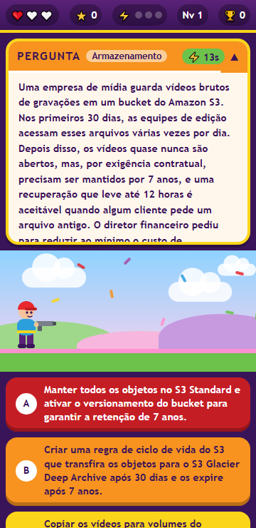
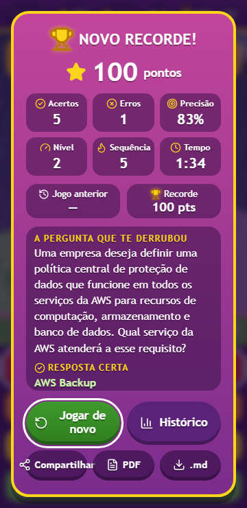
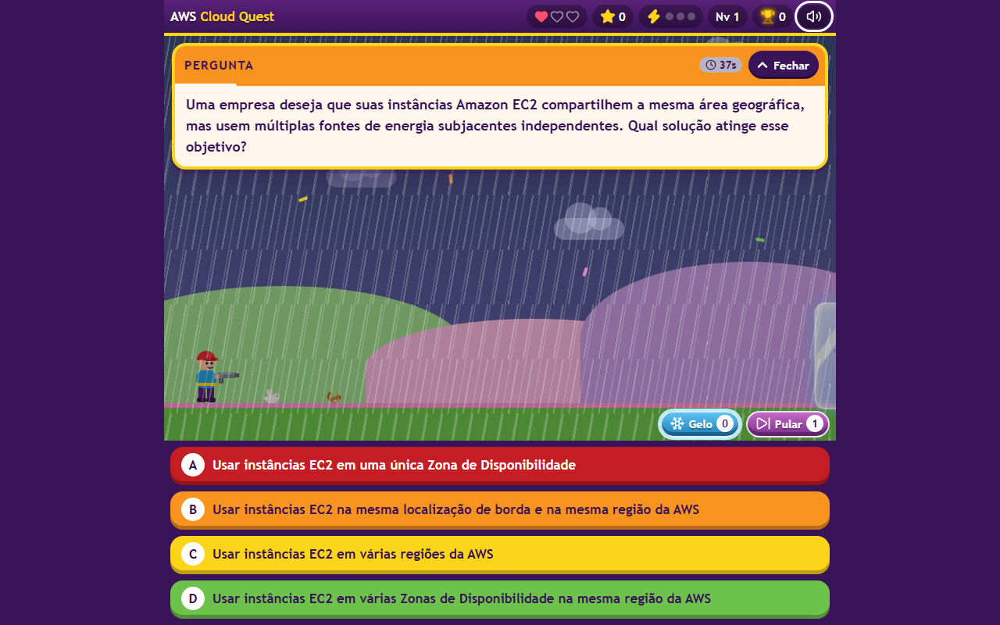

# AWS Cloud Quest

**A real-time quiz game for practicing AWS certification topics.** Monsters walk in from the right; shoot the correct answer before they reach you.

[](https://github.com/iWIPER/awscloudquest/actions/workflows/ci.yml)
[](https://github.com/iWIPER/awscloudquest/actions/workflows/pages.yml)
[](https://iwiper.github.io/awscloudquest/)
[](LICENSE)

**▶ Play now:** <https://iwiper.github.io/awscloudquest/>

The game interface is in Brazilian Portuguese; the code and documentation are in English.

<p align="center">
  
  &nbsp;
  
  &nbsp;
  
</p>
<p align="center">
  
</p>

> Screenshots are captured automatically by the headless smoke test (`scripts/smoke.mjs --shots`).

---

## Contents

- [Features](#features)
- [How to play](#how-to-play)
- [Running locally](#running-locally)
- [Adding questions](#adding-questions)
- [Configuration](#configuration)
- [Project structure](#project-structure)
- [Development](#development)
- [Technical decisions](#technical-decisions)
- [Roadmap](#roadmap)
- [License](#license)

## Features

- **Learn while you play.** When you lose a life (and on Game Over) the game pauses and shows the question, the correct answer and why.
- **Pick your hero.** Play as a man or a woman; the choice is remembered.
- **Two difficulty modes.** *Fácil* gives more time and more help; *Avançado* is the full challenge (see the table below).
- **Four monsters, four attacks.** A dinosaur, a dragon, a snake and an alligator, all drawn as inline SVG, each with its own attack animation.
- **Reading time scales with the question.** Long, scenario-style questions give the monster a longer walk; every level makes it faster.
- **Guessing is punished.** A wrong answer locks all options for a few seconds and makes the monster faster.
- **Power-ups.** **Gelo** freezes the monster in an ice cube for 15 seconds; **Pular** swaps the question without losing a life.
- **Fast-hit bonus.** Three first-try answers within 15 seconds earn a life (up to 3), or bonus points when lives are full.
- **A living world.** Day and night, rain with thunder, birds in the sky, bunnies and squirrels on the ground.
- **Sound and music.** Synthesized in code (no audio files): effects, rain, birdsong, crickets and suspense music that speeds up as the monster gets closer. Mute with one tap or `M`.
- **Spaced review of mistakes.** Questions you miss more often than you get right come back more often in the next deck.
- **No repeats in a row.** Questions and options are shuffled on every showing, and a question never appears twice back to back.
- **Game Over summary** with points, hits, misses, accuracy, level, best streak and time played.
- **History and best score**, stored locally in the browser (last 50 games).
- **Mobile first.** Touch targets of at least 44 px, the layout fits 360 px screens, and long text scrolls inside its panel instead of breaking the page.
- **Accessible.** Real buttons, full keyboard play, `aria-live` feedback, managed focus in dialogs, AA contrast and `prefers-reduced-motion` support.
- **No build step and no runtime dependencies.** Works from GitHub Pages or by opening `index.html` from disk.

## How to play

| Action | Touch / mouse | Keyboard |
|---|---|---|
| Shoot an option | Tap the option | `1`–`6` or `A`–`F` |
| Open / close the question | **Fechar** / **Abrir** | `Q` |
| Freeze the monster (Gelo) | ❄ button on the ground | `G` |
| Skip the question (Pular) | ⏭ button on the ground | `P` |
| Mute / unmute | 🔊 button in the HUD | `M` |
| Start, continue, play again | Tap the button | `Enter` or `Space` |
| Close the history | **Fechar** | `Esc` |

1. Choose your character and a difficulty mode, then a question appears and a monster starts walking from the right.
2. Shoot the correct option. A **hit** kills the monster and scores points.
3. A **miss** eliminates that option, breaks your streak, locks all options for a few seconds and makes the monster faster. The question stays open.
4. If the monster **reaches you**, you lose a life and see the correct answer and explanation.
5. You start with **1 life** (max. 3). Three fast hits (first try, within 15 s) earn one more.
6. Use **Gelo** to buy time or **Pular** to get rid of a question.

| | Fácil | Avançado |
|---|---|---|
| Time before the monster arrives | +10 s per question | normal |
| Gelo (freeze 15 s) | 5 per game | 3 per game |
| Pular (skip) | 3 per game | 2 per game |
| Lockout after a miss | 5 s | 8 s |
| Monster speed-up per miss | +30% | +40% |

**Score per hit:** `10 + min(streak, 10) × 2 + 10 if fast`. You level up every 3 hits.

## Running locally

No installation is needed to play:

```bash
git clone https://github.com/iWIPER/awscloudquest.git
cd awscloudquest
# then open index.html in your browser
```

To serve over HTTP (for example, to play on a phone on the same Wi-Fi):

```bash
node scripts/serve.mjs            # http://localhost:8080
node scripts/serve.mjs 8080 --lan # also prints http://<your-ip>:8080 for other devices
```

Requires Node.js 20 or newer for the scripts. The game itself only needs a browser.

## Adding questions

Questions live in [`data/questions.js`](data/questions.js), a plain script that sets `window.QUESTIONS`. To add one, copy a block, paste it before the final `];` and commit. This works from the GitHub web editor too.

```js
{
  id: "s3-versioning",              // optional, stable id (derived from the text if missing)
  topic: "Armazenamento",           // optional, shown as a tag
  q: "Qual recurso do Amazon S3 mantém versões anteriores de um objeto?",
  options: ["Versionamento", "Replicação", "Ciclo de vida", "Transfer Acceleration"],
  answer: "A",                      // letter (A–F) or 0-based index
  explanation: "O versionamento guarda todas as versões de um objeto no mesmo bucket."
},
```

Rules: 2 to 6 options, `answer` must point to one of them, and no duplicate ids or question texts. Invalid items are skipped by the game (with a warning on the start screen) and rejected by CI.

```bash
npm run validate   # same rules as the game; exits with an error if anything is wrong
```

To bulk-import from JSON, use `node scripts/import-questions.mjs file.json --prefix my-set`. See [docs/ADDING_QUESTIONS.md](docs/ADDING_QUESTIONS.md) for the full format, examples, the importer and common mistakes.

> The questions are study material maintained in this repository. They are **not** official AWS exam questions, and answer keys come exclusively from the bank: the game never generates or corrects them.

## Configuration

All gameplay rules live in one object in [`js/config.js`](js/config.js). The values below are the base game (*Avançado*). `MODES` lists each difficulty mode's overrides; anything a mode does not list keeps the base value, and `DEFAULT_MODE` is the mode used until the player picks one.

| Key | Default | Meaning |
|---|---|---|
| `START_LIVES` | `1` | Lives at the start of a game |
| `MAX_LIVES` | `3` | Life cap |
| `FAST_SECONDS` | `15` | A first-try hit within this many seconds is a fast hit |
| `FAST_NEEDED` | `3` | Fast hits needed to earn a life |
| `FULL_LIVES_BONUS` | `50` | Points awarded instead of a life when lives are full |
| `QUESTION_AUTOCLOSE` | `20` | Seconds before the question panel collapses |
| `THINK_SECONDS` | `20` | Base seconds of monster travel |
| `READ_CHARS_PER_SEC` | `25` | Reading speed used to add travel time per character |
| `LEVEL_SPEEDUP` | `0.05` | Travel time reduction per level |
| `MIN_FACTOR` | `0.55` | Lowest travel factor (speed cap) |
| `DANGER_AT` | `0.72` | Monster progress at which the field pulses red |
| `QUESTIONS_PER_LEVEL` | `3` | Hits per level |
| `WRONG_LOCK_SECONDS` | `8` | After a miss, no option can be shot for this long |
| `WRONG_SPEEDUP` | `0.4` | Each miss makes the current monster this much faster (+40%) |
| `MAX_SPEED` | `2.5` | Speed cap for a monster after many misses (×2.5) |
| `POWER_FREEZE` | `3` | **Gelo** uses per game |
| `FREEZE_SECONDS` | `15` | How long **Gelo** keeps the monster frozen |
| `POWER_SKIP` | `2` | **Pular** uses per game |
| `DEFAULT_MODE` | `"advanced"` | Mode used until the player picks one |
| `MODES.easy` | see the table in *How to play* | *Fácil*: `THINK_SECONDS` 30, `POWER_FREEZE` 5, `POWER_SKIP` 3, `WRONG_LOCK_SECONDS` 5, `WRONG_SPEEDUP` 0.3 |
| `POINTS_BASE` | `10` | Points per hit |
| `POINTS_PER_STREAK` | `2` | Extra points per hit already in the streak |
| `STREAK_CAP` | `10` | Streak value at which the streak bonus stops growing |
| `POINTS_FAST` | `10` | Extra points for a fast hit |
| `REVIEW_MISSED` | `true` | Questions missed more than answered get extra copies in the deck |
| `REVIEW_MAX_COPIES` | `2` | Maximum extra copies per question |
| `MIN_OPTIONS` / `MAX_OPTIONS` | `2` / `6` | Allowed number of options |
| `HISTORY_LIMIT` | `50` | Games kept in local storage |
| `HISTORY_SHOWN` | `20` | Games listed on the history screen |
| `AMBIENT_CYCLE_SECONDS` | `240` | Length of a full day → night → day cycle |
| `AMBIENT_RAIN_EVERY` / `AMBIENT_RAIN_LASTS` | `[70, 160]` / `[25, 50]` | Random seconds between rains / rain duration |
| `AMBIENT_BIRDS_EVERY` / `AMBIENT_CRITTERS_EVERY` | `[7, 16]` / `[12, 26]` | Random seconds between birds / bunnies and squirrels |
| `MAX_DT_MS` | `50` | Largest loop step (prevents jumps after the tab was hidden) |
| `SHOT_MS`, `DYING_MS`, `NEXT_AFTER_HIT_MS`, `HERO_BLINK_MS`, `CONFETTI_COUNT` | | Animation timings and effects |

**Monster travel time** = `(THINK_SECONDS + characters / READ_CHARS_PER_SEC) × max(MIN_FACTOR, 1 − LEVEL_SPEEDUP × (level − 1))`, where *characters* counts the question and all options.

## Project structure

```
├── index.html               # page markup; loads the scripts below in order
├── css/style.css            # all styles (design tokens in :root)
├── js/
│   ├── config.js            # CONFIG: every gameplay rule
│   ├── questions.js         # bank validation, normalization and deck building (pure)
│   ├── rules.js             # travel time, score, fast hits, levels (pure)
│   ├── storage.js           # localStorage: best score, history, stats, character, mute
│   ├── icons.js             # Lucide icons as inline SVG
│   ├── sound.js             # Web Audio: effects, rain, suspense music (synthesized)
│   ├── monsters.js          # monster SVGs, metadata and attack choreography
│   ├── hero.js              # the two playable characters and their end states
│   ├── effects.js           # bullet, confetti, floating text, balloons, fire, penalty sign
│   ├── ambient.js           # day/night, rain, thunder, birds, critters, crickets
│   ├── report.js            # end-of-game report: Markdown export and printable PDF
│   ├── ui.js                # HUD, question balloon, answers, power-ups, overlays
│   ├── game.js              # state machine and requestAnimationFrame loop
│   └── main.js              # bootstrap and input wiring
├── data/questions.js        # the question bank (window.QUESTIONS)
├── assets/                  # app icons and the link preview image
├── manifest.webmanifest     # installable web app metadata
├── sitemap.xml              # for search engines
├── tests/                   # node:test unit tests for the pure modules
├── scripts/
│   ├── validate-questions.mjs
│   ├── import-questions.mjs
│   ├── check-syntax.mjs
│   ├── serve.mjs
│   ├── build-assets.mjs     # renders the icons and the link preview image
│   └── smoke.mjs            # Playwright smoke test (optional dev dependency)
├── docs/                    # ADDING_QUESTIONS, ARCHITECTURE, DECISIONS, images
└── .github/                 # CI, Pages deploy, issue templates
```

See [docs/ARCHITECTURE.md](docs/ARCHITECTURE.md) for the game loop, the state machine and what is stored locally.

## Development

```bash
npm run check      # node --check on every JavaScript file
npm run validate   # question bank
npm test           # unit tests (node:test, no dependencies)
npm run ci         # all three

# Optional: headless browser smoke test
npm install
npx playwright install chromium
npm run smoke      # add -- --shots shots/ to save screenshots
npm run assets     # re-render icons and the link preview image
```

Every push runs [CI](.github/workflows/ci.yml): syntax check, bank validation, unit tests and the smoke test at 360 px and 1280 px, in both Chromium and WebKit (the Safari / iPhone engine). Pushes to `main` are deployed to GitHub Pages by [pages.yml](.github/workflows/pages.yml), which re-runs the checks first and publishes only `index.html`, `css/`, `js/` and `data/`.

Commits follow [Conventional Commits](https://www.conventionalcommits.org/). See [CONTRIBUTING.md](CONTRIBUTING.md). Dependabot keeps the GitHub Actions and the dev dependency up to date, and security reports go through [SECURITY.md](SECURITY.md).

### Search and sharing

The page ships what search engines and link previews look for: a descriptive title and meta description, a canonical URL, `schema.org` structured data (JSON-LD), Open Graph and Twitter Card tags with a 1200×630 preview image, a web app manifest with icons, and a `sitemap.xml`. New deploys can be announced to Bing and other IndexNow engines with the key file at the site root. `tests/seo.test.js` keeps all of this consistent.

## Technical decisions

- **Plain HTML, CSS and JavaScript.** It opens in seconds on a phone, needs no build and is native to GitHub Pages. A Python/Pygame build would have to ship WebAssembly (tens of MB) and has weak touch input.
- **Classic scripts instead of ES modules.** Browsers refuse to load module scripts from `file://`, and the game must work by opening `index.html` directly. Each file adds itself to a single `window.AwsCloudQuest` namespace and the scripts load in a fixed order.
- **The question bank is a `.js` file**, not `.json`, because `fetch` also fails on `file://`.
- **One set of validation rules.** `js/questions.js` has no DOM code, so the game, the CLI validator and the tests all run the same `normalize()`.
- **Deterministic answers.** The game never infers, generates or fixes an answer; there are no AI or external API calls.
- **Bank text is rendered with `textContent`**, never `innerHTML`.
- **Sound is synthesized with the Web Audio API**, not loaded from files, so the game stays tiny and works offline. Browsers only allow audio after a tap, so it starts on the first interaction. On iPhone the game requests the media playback audio session, so sound also plays with the ring/silent switch on; the in-game mute button controls it.
- **Difficulty modes are data, not code.** A mode is a set of `CONFIG` overrides; the game, the UI and the "Como jogar" text all read the effective configuration.
- **Icons are [Lucide](https://lucide.dev)**, embedded as inline SVG (ISC license, see [THIRD_PARTY_NOTICES.md](THIRD_PARTY_NOTICES.md)) instead of loaded from a CDN.

The full log, with alternatives considered, is in [docs/DECISIONS.md](docs/DECISIONS.md).

## Roadmap

Ideas for future versions. None of these are implemented yet.

- [ ] Multiple-answer questions ("choose two"), where `answer` is an array and the player must land N different hits. The mechanic is still to be decided.
- [ ] Filter by topic and a "review my mistakes only" mode.
- [ ] Import questions from the UI (paste JSON) and export/import the history.
- [ ] Vibration on phones and a separate volume control for music and effects.
- [ ] PWA with offline cache.
- [ ] More monsters, power-ups and scenery per level.

## License

[MIT](LICENSE) © Wilk Pereira Cosentino. Icons by Lucide (ISC), see [THIRD_PARTY_NOTICES.md](THIRD_PARTY_NOTICES.md).

AWS Cloud Quest is an independent study project. It is not affiliated with, endorsed by or sponsored by Amazon Web Services. AWS and related service names are trademarks of Amazon.com, Inc. or its affiliates.
