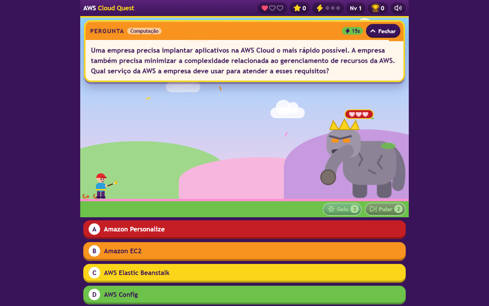
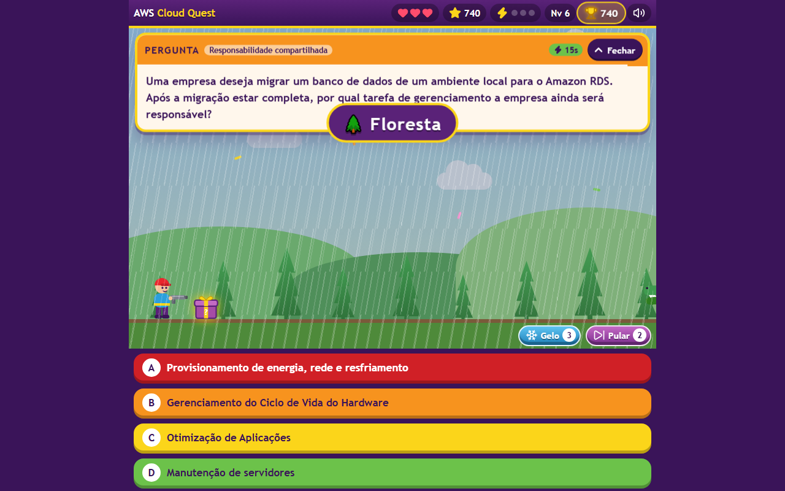

# AWS Cloud Quest

A real-time quiz game for studying the **AWS Certified Cloud Practitioner (CLF-C02)** exam. Monsters walk in from the right. Shoot the correct answer before they reach you.

[](https://github.com/iWIPER/awscloudquest/actions/workflows/ci.yml)
[](https://github.com/iWIPER/awscloudquest/actions/workflows/pages.yml)
[](https://iwiper.github.io/awscloudquest/)
[](LICENSE)

**▶ Play now:** <https://iwiper.github.io/awscloudquest/>

The game is in Brazilian Portuguese. Code and documentation are in English.

<p align="center">
  
  &nbsp;
  
  &nbsp;
  
</p>
<p align="center">
  
</p>
<p align="center">
  
</p>

> Screenshots come from the headless smoke test (`scripts/smoke.mjs --shots`).

## Contents

**For players**

- [Start studying](#start-studying)
- [Features](#features)
- [How to play](#how-to-play)
- [Duel 1×1](#duel-11)

**For contributors**

- [Running locally](#running-locally)
- [Adding questions](#adding-questions)
- [Configuration](#configuration)
- [How it was built](#how-it-was-built)
- [Project structure](#project-structure)
- [Development](#development)
- [Roadmap](#roadmap)

[License](#license)

# For players

## Start studying

1. Open **<https://iwiper.github.io/awscloudquest/>** on your phone or computer. Nothing to install and no account needed.
2. Tap **Jogar**, choose a character and a mode, then **Começar**.
3. At the end of each game, open **Desempenho** to see your strong and weak areas, with what to study and links to the AWS docs. Download the report as PDF to keep track.

To study with a friend, tap **Duelo 1×1 com um amigo**, create a room and send the link (see [Duel 1×1](#duel-11)).

Your history, best score and reports stay in your own browser. The solo game sends nothing anywhere. A duel sends your name and your answers through a public message relay so the other player can see them (details in [Duel 1×1](#duel-11)). Clearing the browser data erases your history, so download the PDF of games you want to keep.

Tip: on a phone, use the browser's "Add to Home Screen" to open the game like an app.

## Features

**Study**

- Every lost life and every Game Over shows the question, the correct answer and the explanation.
- Questions you miss more than you get right come back more often.
- Reading time scales with the length of the question and its options. Very long questions get +30 s.
- **Desempenho por área**: hits and misses per CLF-C02 domain and topic, with strengths, weak areas, what to study and links to the official AWS docs.
- Reports per game as **PDF** (view or download, no print dialog) or **Markdown**, from the Game Over card or from the history.

**Gameplay**

- Two characters (man or woman) and two modes (**Fácil** and **Avançado**), chosen before each session.
- Seven monsters with their own attacks: dinosaur, dragon, snake, alligator, gorilla, wolf and giant spider.
- **Boss fight** every 15 hits (first at 12): four looks (stone golem, lava golem, ice giant, giant robot), 3 hearts, 4 questions.
- **Mystery box** every 6–8 questions swaps the weapon: pistol, bow, slingshot or magic wand.
- **Power-ups**: Gelo freezes the monster for 15 s; Pular swaps the question.
- A miss locks the answers for a few seconds and makes the monster faster.
- Three fast first-try hits earn a life.

**Duel 1×1**

- Play a friend in real time: create a room, share the link, and the match starts when they join.
- Same question for both; the first correct answer shoots the other player. 10 or 20 lives each.
- Wild West town with day, night and rain, "PROCURADO" posters, a fast showdown theme, a "ROUND N" presentation, taunt signs, a podium beside the Brazil flag, rematch with a running score, and a report for each player.

**World and sound**

- Four sceneries that change every 15 hits: field, forest, desert and city.
- Day and night, rain with thunder, birds, bunnies, squirrels, deer, camels and cars.
- A visitor with a dog and a sign cheers you on at milestones.
- "READY? / GO!" intro and a dark "GAME OVER" screen.
- All sound is synthesized in code: effects, rain, a heartbeat when the screen turns red and music per scenery. Mute with one tap or `M`.

**Platform**

- Mobile first. The page never scrolls; long text scrolls inside its panel. Tested from 320 px phones to desktop, in Chromium and WebKit.
- Keyboard play, `aria-live` feedback, focus management in dialogs, AA contrast and `prefers-reduced-motion`.
- No build step and no runtime dependencies. Runs on GitHub Pages or from `index.html` on disk.

## How to play

| Action | Touch / mouse | Keyboard |
|---|---|---|
| Shoot an option | Tap the option | `1`–`6` or `A`–`F` |
| Open / close the question | **Fechar** / **Abrir** | `Q` |
| Freeze the monster (Gelo) | ❄ button on the ground | `G` |
| Skip the question (Pular) | ⏭ button on the ground | `P` |
| Open the mystery box | Tap the box | `X` |
| Mute / unmute | 🔊 button in the HUD | `M` |
| Start, continue, play again | Tap the button | `Enter` or `Space` |
| Close a screen | **Fechar** / **Voltar** | `Esc` |

1. Tap **Jogar**, choose a character and a mode, then tap **Começar**.
2. A question appears and a monster walks in from the right. Shoot the correct option.
3. A miss eliminates the option, locks the answers and speeds the monster up.
4. If the monster reaches you, you lose a life and see the answer and the explanation.
5. You start with 1 life (max. 3).

| | Fácil | Avançado |
|---|---|---|
| Time per question | +10 s | normal |
| Gelo (freeze 15 s) | 5 per game | 3 per game |
| Pular (skip) | 3 per game | 2 per game |
| Lockout after a miss | 5 s | 8 s |
| Speed-up per miss | +30% | +40% |

**Boss fight.** The boss stands still and throws rocks. Hit 3 of 4 questions to win +100 points and +1 life. A miss or a timeout only staggers the hero, and the boss steps closer. If you lose the fight, the boss crushes you and you lose a life. Gelo and Pular are disabled during the fight.

**Score per hit:** `10 + min(streak, 10) × 2 + 10 if fast`. You level up every 3 hits.

## Duel 1×1

1. On the start screen, tap **Duelo 1×1 com um amigo**, type your name, pick your character, choose **10 or 20 lives** and tap **Criar sala**.
2. Send the link (**Copiar link** or **Compartilhar**). The room waits 5 minutes.
3. Your friend opens the link, types a name, picks a character and taps **Entrar no duelo**.
4. Both tap **Pronto!**. A 10-second countdown starts, then "SAQUE!" and round 1.
5. Each round, both players get the same question with the options in the same order. You stand on the left; your friend stands on the right on your screen, and the other way around on theirs.

| Situation | What happens |
|---|---|
| First correct answer | That player shoots; the other loses 1 life |
| Wrong answer | That player is locked until the round ends; the other can still answer |
| Both wrong, or time runs out | Both lose 1 life |
| Both reach 0 in the same round | Draw: both climb a wide podium, "<A> E <B> EMPATARAM!", nobody gets the trophy |
| A player reaches 0 | The other puts the gun away, climbs the podium beside the Brazil flag and jumps for joy; the screen darkens with "<NAME> VENCEU!" until you tap (time for a screenshot), then the end card |
| A connection drops | The match pauses: "<Nome> caiu. Esperando reconectar… 2:00". If they come back, the round starts over; if not, the room closes |

Each round opens with a "ROUND N" sign and a drum hit; the question appears about 3 seconds later. Each player starts with 10 or 20 lives, as the room creator chose. The round time follows the solo formula and gets shorter every 3 rounds. "First" means the shortest time on each player's own screen, so a slow connection does not lose the round. At the end, the card shows both characters with the matches each one won in this room. **Revanche** starts a new match when both tap it, and the score carries over. **Desempenho**, **PDF** and **.md** give each player their own report: the duel result on top, then the usual performance by area. **Início** asks you to download the report first, then leaves the room. The other player sees "<Nome> saiu da sala." A dropped player gets 2 minutes to come back before the room closes; the browser also reconnects by itself.

**How the two phones talk.** The game is a static site with no server of its own. Messages go through a free public MQTT relay (HiveMQ, with EMQX as fallback) over a secure connection, inside a room whose random id only exists in the link. Only player names, character choices, the question and option order, answers and results are sent. Nothing else leaves the browser, and no account is needed. Rooms are not stored anywhere: a room is just a channel name while both browsers are connected. Messages are not kept by the relay. When a player leaves, or after 5 minutes without anyone joining, the browser disconnects and the room is gone. While connected, each browser sends one small "still here" message every 5 seconds.

# For contributors

Everything below is for people who want to change the game or add questions. To play, the link above is all you need.

## Running locally

```bash
git clone https://github.com/iWIPER/awscloudquest.git
cd awscloudquest
# open index.html in a browser
```

To play on a phone on the same Wi-Fi:

```bash
node scripts/serve.mjs 8080 --lan   # prints http://<your-ip>:8080
```

On the phone, open the printed address (`localhost` only works on the computer itself). If Windows asks, allow Node.js on private networks. The scripts need Node.js 20+. The game only needs a browser.

## Adding questions

Questions live in [`data/questions.js`](data/questions.js), a script that sets `window.QUESTIONS`.

```js
{
  id: "s3-versioning",
  topic: "Armazenamento",
  q: "Qual recurso do Amazon S3 mantém versões anteriores de um objeto?",
  options: ["Versionamento", "Replicação", "Ciclo de vida", "Transfer Acceleration"],
  answer: "A",
  explanation: "O versionamento guarda todas as versões de um objeto no mesmo bucket."
},
```

`topic` is optional. Without it, a keyword classifier assigns one of the 18 topics in [`data/study-guide.js`](data/study-guide.js), so new questions show up in **Desempenho por área** automatically.

```bash
npm run validate                                                  # check the bank
node scripts/import-questions.mjs file.json --prefix sim03        # bulk import
```

Full format, import rules and common mistakes: [docs/ADDING_QUESTIONS.md](docs/ADDING_QUESTIONS.md).

> The questions are study material, not official AWS exam questions. Answer keys come only from the bank. The game never generates or corrects them.

## Configuration

Every gameplay number lives in [`js/config.js`](js/config.js). `MODES` holds each mode's overrides. The most useful keys:

| Key | Default | Meaning |
|---|---|---|
| `START_LIVES` / `MAX_LIVES` | `1` / `3` | Lives at the start / life cap |
| `THINK_SECONDS` | `20` | Base seconds before the monster arrives |
| `READ_CHARS_PER_SEC` | `25` | Extra time per character of question and options |
| `LONG_READ_CHARS` / `LONG_READ_BONUS` | `500` / `30` | Long-read threshold / extra seconds |
| `LEVEL_SPEEDUP` / `MIN_FACTOR` | `0.05` / `0.55` | Speed-up per level / speed cap |
| `WRONG_LOCK_SECONDS` / `WRONG_SPEEDUP` | `8` / `0.4` | Lockout and speed-up after a miss |
| `POWER_FREEZE` / `FREEZE_SECONDS` / `POWER_SKIP` | `3` / `15` / `2` | Gelo uses, Gelo duration, Pular uses |
| `WEAPON_BOX_EVERY` | `[6, 8]` | Questions between mystery boxes |
| `SCENE_EVERY` | `15` | Hits between scenery changes |
| `CHEER_FIRST` / `CHEERS` | `[5, 7]` / 25, 50, 100, 200 | Visitor milestones |
| `BOSS_FIRST` / `BOSS_EVERY` | `12` / `15` | Hits before the first boss / between bosses |
| `BOSS_HP` / `BOSS_ROUNDS` | `3` / `4` | Hits to win / questions per fight |
| `BOSS_BONUS` / `BOSS_HIT_BONUS` | `100` / `15` | Points for winning / per hit when losing |
| `HISTORY_LIMIT` / `REPORTS_LIMIT` | `50` / `20` | Games and reports kept in the browser |
| `DUEL.LIVES_OPTIONS` / `DUEL.COUNTDOWN` | `[10, 20]` / `10` | Lives the room creator can pick / countdown seconds |
| `DUEL.ROUND_INTRO_MS` | `2800` | "ROUND N" presentation before each question |
| `DUEL.PEER_SILENT_MS` / `DUEL.RECONNECT_MS` | `15000` / `120000` | Silence that pauses the match / time a dropped player has to come back |
| `DUEL.LEVEL_EVERY` | `3` | Rounds per duel level (round time shrinks) |
| `DUEL.GRACE_MS` / `DUEL.TIMEOUT_GRACE_MS` | `350` / `3000` | Wait for a faster answer / extra time past the round for network delay |
| `DUEL.ROOM_TTL_MS` | `300000` | An empty room expires after 5 minutes |
| `DUEL.BROKERS` | HiveMQ, EMQX | Public MQTT relays, tried in order |

**Travel time** = `(THINK_SECONDS + characters / READ_CHARS_PER_SEC) × max(MIN_FACTOR, 1 − LEVEL_SPEEDUP × (level − 1))`, plus `LONG_READ_BONUS` for long reads.

## How it was built

**Stack.** Plain HTML, CSS and JavaScript (ES2020), loaded as classic scripts on one `window.AwsCloudQuest` namespace. No framework, no bundler, no runtime dependency. Classic scripts and a `.js` question bank keep the game working from `file://`, where browsers block ES modules and `fetch`.

**Graphics.** Characters, monsters, bosses, sceneries, critters and effects are inline SVG and CSS animations, drawn for this project. Icons are [Lucide](https://lucide.dev) (ISC), embedded as inline SVG.

**Sound.** Synthesized at runtime with the Web Audio API: oscillators, filtered noise and envelopes. There are no audio files. Music uses only sine and triangle waves to stay soft. On iPhone the game requests the media playback audio session, so sound plays with the silent switch on.

**Duel networking.** [`js/net.js`](js/net.js) is a minimal MQTT 3.1.1 client written for this project (connect, subscribe, publish, ping) that talks to a free public broker over a secure WebSocket. The room creator's browser is the referee ([`js/duel-rules.js`](js/duel-rules.js)), so there is still no server to run or pay for.

**PDF.** A small PDF 1.4 writer in [`js/pdf.js`](js/pdf.js) builds the report in the browser: built-in Helvetica, WinAnsi text, wrapping, boxes and clickable links. No library and no print dialog.

**Study content.** Questions are practice material kept in this repository. The study guide maps them to the four CLF-C02 domains from the [official exam guide](https://aws.amazon.com/certification/certified-cloud-practitioner/). Each topic links to AWS documentation, and every link is checked.

**Tooling.** Node.js built-ins only: `node:test` for unit tests and a small static server. [Playwright](https://playwright.dev) is the one dev dependency, used for the smoke and layout tests in Chromium and WebKit. GitHub Actions runs CI and deploys to GitHub Pages.

Design notes and the alternatives considered: [docs/DECISIONS.md](docs/DECISIONS.md). Modules, state machine and data flow: [docs/ARCHITECTURE.md](docs/ARCHITECTURE.md).

## Project structure

```
├── index.html               # markup; loads the scripts in order
├── css/style.css            # all styles (design tokens in :root)
├── data/
│   ├── questions.js         # question bank (window.QUESTIONS)
│   └── study-guide.js       # CLF-C02 domains, topics, keywords and study links
├── js/
│   ├── config.js            # every gameplay number (CONFIG, MODES)
│   ├── questions.js         # bank validation, deck building (pure)
│   ├── topics.js            # keyword topic classifier (pure)
│   ├── rules.js             # travel time, score, events, boss (pure)
│   ├── storage.js           # localStorage access (pure, backend injected)
│   ├── icons.js             # Lucide icons
│   ├── sound.js             # Web Audio effects and music
│   ├── monsters.js          # monsters, bosses and attacks
│   ├── hero.js              # characters, weapons and end states
│   ├── effects.js           # shots, rocks, confetti, balloons, fire
│   ├── ambient.js           # sceneries, day/night, weather, critters
│   ├── visitor.js           # the cheering visitor and the dog
│   ├── net.js               # minimal MQTT-over-WebSocket client (duel rooms)
│   ├── duel-rules.js        # duel referee rules: rounds, lives, draw (pure)
│   ├── pdf.js               # minimal PDF writer
│   ├── report.js            # areas analysis, Markdown and PDF reports
│   ├── ui.js                # DOM: HUD, question, answers, dialogs
│   ├── game.js              # state machine and main loop
│   ├── duel.js              # duel 1×1: room, rounds, victory scene, report
│   └── main.js              # bootstrap and input
├── tests/                   # node:test unit tests
├── scripts/                 # validate, import, serve, smoke, responsive, assets
├── assets/                  # app icons and link preview image
└── docs/                    # architecture, decisions, question guide
```

## Development

```bash
npm run ci          # syntax check + bank validation + unit tests

npm install
npx playwright install chromium webkit
npm run smoke                                   # full game flows, 360 px and 1280 px
node scripts/smoke.mjs --browser webkit         # same in the Safari engine
node scripts/duel-smoke.mjs                     # a full duel between two pages
node scripts/responsive.mjs                     # 10 screen sizes, nothing cut off
npm run assets                                  # re-render icons and preview image
```

CI runs on every push: syntax, bank, unit tests, and the solo and duel smoke tests in Chromium and WebKit. Pushes to `main` deploy to GitHub Pages. Commits follow [Conventional Commits](https://www.conventionalcommits.org/). See [CONTRIBUTING.md](CONTRIBUTING.md) and [SECURITY.md](SECURITY.md).

The page ships a canonical URL, JSON-LD, Open Graph and Twitter tags, a web app manifest, a sitemap and an IndexNow key. `tests/seo.test.js` keeps them consistent.

## Roadmap

- [ ] Multiple-answer questions ("choose two").
- [ ] Filter by topic and a "review my mistakes" mode.
- [ ] Import questions from the UI and export/import the history.
- [ ] Offline play (PWA cache).

## License

[MIT](LICENSE) © Wilk Pereira Cosentino. Icons by Lucide (ISC), see [THIRD_PARTY_NOTICES.md](THIRD_PARTY_NOTICES.md).

AWS Cloud Quest is an independent study project. It is not affiliated with, endorsed by or sponsored by Amazon Web Services. AWS and related service names are trademarks of Amazon.com, Inc. or its affiliates.
