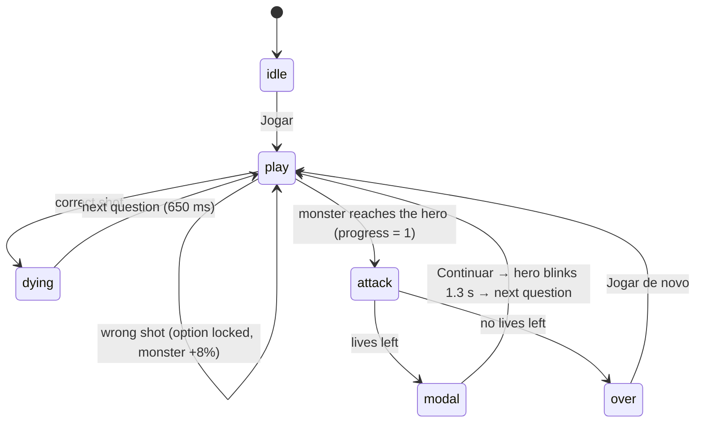

# Architecture

AWS Cloud Quest is a static page: one HTML file, one stylesheet and a set of classic scripts loaded in order. There is no build step and nothing is fetched at runtime.

## Loading order

```
data/questions.js   → window.QUESTIONS (the only loose global)
js/config.js        → AwsCloudQuest.config
js/questions.js     → AwsCloudQuest.questions   (pure)
js/rules.js         → AwsCloudQuest.rules       (pure)
js/storage.js       → AwsCloudQuest.storage
js/monsters.js      → AwsCloudQuest.monsters
js/hero.js          → AwsCloudQuest.hero
js/effects.js       → AwsCloudQuest.effects
js/ui.js            → AwsCloudQuest.ui
js/game.js          → AwsCloudQuest.game
js/main.js          → validates the bank, creates everything, wires input, boots
```

Each file is an IIFE that attaches its API to `window.AwsCloudQuest`. The pure files (`config`, `questions`, `rules`, `storage`) also set `module.exports` when present, so Node can `require()` them for the tests and the CLI scripts without a bundler.

## Module responsibilities

| Module | Knows about | Does not know about |
|---|---|---|
| `questions` | bank format, validation, deck building, option shuffling, `{w, r}` stats | DOM, storage, time |
| `rules` | travel time, score, levels, fast hits, wrong-answer push | DOM, storage |
| `storage` | localStorage keys and shapes; failures fall back to defaults | game rules |
| `monsters` / `hero` | SVG art, attack choreography, hero end states | score, lives |
| `effects` | short-lived DOM effects that remove themselves | game state |
| `ui` | DOM elements, text in Portuguese, focus, overlays | rules (it only shows what it receives) |
| `game` | state machine, loop, timers, wiring all of the above | DOM ids beyond what `main` passes in |
| `main` | bootstrapping, events, keyboard | rules |

## State machine



| Phase | What happens |
|---|---|
| `idle` | Start screen. The loop runs, but nothing moves. |
| `play` | The only phase that advances game time: monster progress, the fast-hit timer and the panel auto-close timer. Shots are accepted. |
| `dying` | The monster spins and shrinks, confetti, "+points". The next question comes after `NEXT_AFTER_HIT_MS`. |
| `attack` | The monster's own attack runs for its `attackMs` (1500–2000 ms). Answers are locked. |
| `modal` | "Life lost" card with the question, the right answer and the explanation. After **Continuar**, the hero blinks for `HERO_BLINK_MS`, still in this phase, then a new question starts. |
| `over` | Game Over card. The hero stays in its final state (eaten, burned or squeezed). |

A shot is ignored when the phase is not `play`, when a bullet is already in flight, or when the option is locked. The bullet takes `SHOT_MS`. If the monster arrives during the flight, the shot is dropped.

## Main loop

`game.js` runs one `requestAnimationFrame` loop for the whole session:

1. `dt = min(now − lastFrame, MAX_DT_MS)`. The cap means a hidden tab, a debugger pause or a slow frame can never teleport the monster. On `visibilitychange` the clock is reset, so the first frame after returning has `dt = 0`.
2. The field is measured (`clientWidth`/`clientHeight`) every frame, and again on `resize`. All positions are computed in pixels from that, so rotating a phone simply re-lays everything out.
3. Only in `play`: `elapsed += dt`, `progress += dt / travel`, the panel timer counts down, and the danger vignette turns on when `progress > DANGER_AT`. At `progress ≥ 1` the attack starts.
4. The hero and monster are positioned with `transform` only.

## Monster travel time

```
chars  = length(question) + Σ length(options)
base   = THINK_SECONDS + chars / READ_CHARS_PER_SEC
factor = max(MIN_FACTOR, 1 − LEVEL_SPEEDUP × (level − 1))
travel = base × factor                              (seconds)
```

With the defaults, a short question (about 150 characters including the options) takes `20 + 150/25 = 26 s` at level 1. The 600-character storage scenario in the bank has five long options (1,245 characters in total) and takes `20 + 1245/25 ≈ 70 s`. From level 10 on, the factor bottoms out at `0.55`.

The monster's left edge moves from the right border of the field (`progress = 0`) to the hero (`progress = 1`). The dragon stops earlier, at `clamp(28% of the field width, 90 px, 170 px)` from the hero, because it attacks with fire. A miss sets `progress = min(0.97, progress + 0.08)`, and progress never moves backwards.

## Fast hits and lives

A hit is fast when it is the first answer to that question (no miss yet) and comes within `FAST_SECONDS`. The timer chip shows ⚡ and the remaining seconds while a fast hit is still possible, then turns grey and shows ⏱ with the time until the monster arrives. Every fast hit lights a ⚡ dot. At `FAST_NEEDED` dots the player gets +1 life, or `FULL_LIVES_BONUS` points if lives are already at `MAX_LIVES`, and the dots reset.

## Deck and review

`buildDeck()` takes the normalized questions and the per-question stats:

- Each question goes in once. If `REVIEW_MISSED` is on and a question has `w > r` (more misses than hits), it gets `min(REVIEW_MAX_COPIES, w − r)` extra copies.
- Copies are arranged so the same question is never adjacent, and the new deck never starts with the last question of the previous deck. A copy that cannot be placed without breaking that rule is dropped.
- The deck is consumed from the front and rebuilt with fresh stats when it runs out.

Stats are updated once per showing. The first miss, or the monster's arrival, records `w + 1` once, no matter how many wrong shots follow. A hit records `r + 1` only if there was no miss on that showing.

## What is stored in localStorage

| Key | Shape | Written when |
|---|---|---|
| `awsCloudQuestBest` | number | Game Over with a new best score |
| `awsCloudQuestHistory` | `[{ t, score, correct, level }]`, newest first, at most `HISTORY_LIMIT` (50) | every Game Over |
| `awsCloudQuestStats` | `{ [questionId]: { w, r } }` | every recorded hit or miss |

Every access is wrapped in `try/catch`. If storage is blocked, the game plays normally and simply doesn't remember anything. **Limpar** on the history screen removes the history and the best score. Review stats are kept, so the deck keeps prioritizing your weak questions.

## Testing

- `tests/*.test.js` (`node:test`): normalization, deck building (adjacency, review copies, deck rollover), travel time, scoring, fast-hit rule, life cap, storage fallbacks, and the repository bank itself.
- `scripts/smoke.mjs` (Playwright, optional): loads the page at 360 px and 1280 px with a fake clock. It plays through a miss, hits, the panel auto-close, a life gain, a life loss and Game Over, runs all four attacks and fails on any console error.
