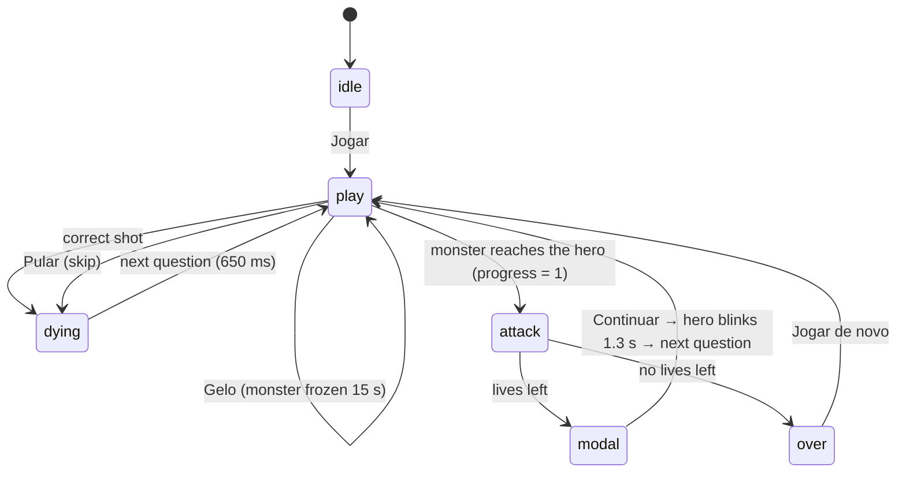

# Architecture

AWS Cloud Quest is a static page: one HTML file, one stylesheet and a set of classic scripts loaded in order. There is no build step, nothing is fetched at runtime, and there are no audio or image files besides the link preview image.

## Loading order

```
data/questions.js   → window.QUESTIONS (the only loose global)
js/config.js        → AwsCloudQuest.config
js/questions.js     → AwsCloudQuest.questions   (pure)
js/rules.js         → AwsCloudQuest.rules       (pure)
js/storage.js       → AwsCloudQuest.storage     (pure, backend injected)
js/icons.js         → AwsCloudQuest.icons
js/sound.js         → AwsCloudQuest.sound
js/monsters.js      → AwsCloudQuest.monsters
js/hero.js          → AwsCloudQuest.hero
js/effects.js       → AwsCloudQuest.effects
js/ambient.js       → AwsCloudQuest.ambient
js/report.js        → AwsCloudQuest.report      (Markdown builder is pure)
js/ui.js            → AwsCloudQuest.ui
js/game.js          → AwsCloudQuest.game
js/main.js          → validates the bank, creates everything, wires input, boots
```

Each file is an IIFE that attaches its API to `window.AwsCloudQuest`. The pure files (`config`, `questions`, `rules`, `storage`, `report`) also set `module.exports` when present, so Node can `require()` them for the tests and the CLI scripts without a bundler.

## Module responsibilities

| Module | Knows about | Does not know about |
|---|---|---|
| `questions` | bank format, validation, deck building, option shuffling, `{w, r}` stats | DOM, storage, time |
| `rules` | travel time, score, levels, fast hits, miss speed-up | DOM, storage |
| `storage` | localStorage keys and shapes; failures fall back to defaults | game rules |
| `icons` | Lucide SVG markup | everything else |
| `sound` | Web Audio synthesis: effects, rain loop, music | game state (it is told what to play) |
| `monsters` / `hero` | SVG art, attack choreography, hero end states | score, lives |
| `effects` | short-lived DOM effects that remove themselves | game state |
| `ambient` | day/night, weather, birds, critters, crickets | game rules |
| `report` | turning a game log into Markdown or a printable page | DOM outside the report section |
| `ui` | DOM elements, text in Portuguese, focus, overlays, power-up buttons | rules (it only shows what it receives) |
| `game` | state machine, loop, timers, power-ups, game log | DOM ids beyond what `main` passes in |
| `main` | bootstrapping, events, keyboard, sound unlock, export and share | rules |

## State machine



| Phase | What happens |
|---|---|
| `idle` | Start screen. The loop and the ambience run, but nothing in the game moves. |
| `play` | The only phase that advances game time: monster progress, the fast-hit timer, the post-miss lockout, the freeze timer and the panel auto-close timer. Shots and power-ups are accepted. |
| `dying` | After a hit, the monster spins and shrinks with confetti and "+points". After a skip, it vanishes in a puff. The next question comes after `NEXT_AFTER_HIT_MS`. |
| `attack` | The monster's own attack runs for its `attackMs` (1500–2000 ms). Answers and power-ups are locked. |
| `modal` | "Life lost" card with the question, the right answer and the explanation. After **Continuar**, the hero blinks for `HERO_BLINK_MS`, still in this phase, then a new question starts. |
| `over` | Game Over card with the player's numbers. The hero stays in its final state (eaten, burned, squeezed or bonked). |

A shot is ignored when the phase is not `play`, when a bullet is already in flight, during the post-miss lockout, or when the option is eliminated. The bullet takes `SHOT_MS`. If the monster arrives during the flight, the shot is dropped.

## Main loop

`game.js` runs one `requestAnimationFrame` loop for the whole session:

1. `dt = min(now − lastFrame, MAX_DT_MS)`. The cap means a hidden tab, a debugger pause or a slow frame can never teleport the monster. On `visibilitychange` the clock is reset, so the first frame after returning has `dt = 0`.
2. The field is measured (`clientWidth`/`clientHeight`) every frame, and again on `resize`. All positions are computed in pixels from that, so rotating a phone simply re-lays everything out.
3. `ambient.update(dt)` runs in every phase.
4. Only in `play`: `elapsed += dt`. If the monster is frozen, `frozenLeft` counts down and progress stands still; otherwise `progress += dt × speed / travel`. The lockout and panel timers count down, the danger vignette turns on when `progress > DANGER_AT`, and the music intensity follows the progress. At `progress ≥ 1` the attack starts.
5. The hero and monster are positioned with `transform` only.

## Monster travel time and speed

```
chars  = length(question) + Σ length(options)
base   = THINK_SECONDS + chars / READ_CHARS_PER_SEC
factor = max(MIN_FACTOR, 1 − LEVEL_SPEEDUP × (level − 1))
travel = base × factor                              (seconds at speed 1)
```

With the defaults, a short question (about 150 characters including the options) takes `20 + 150/25 = 26 s` at level 1. The 600-character storage scenario in the bank has five long options (1,245 characters in total) and takes `20 + 1245/25 ≈ 70 s`. From level 10 on, the factor bottoms out at `0.55`.

Each question starts at `speed = 1`. Every miss adds `WRONG_SPEEDUP` (0.4), up to `MAX_SPEED` (2.5), for the rest of that question. The time left shown in the timer chip is `(1 − progress) × travel / speed`.

The monster's left edge moves from the right border of the field (`progress = 0`) to the hero (`progress = 1`). The dragon stops earlier, at `clamp(28% of the field width, 90 px, 170 px)` from the hero, because it attacks with fire.

## Misses, fast hits and lives

A **miss** eliminates the option, resets the streak, locks every option for `WRONG_LOCK_SECONDS` (8 s, with a countdown banner) and makes the monster faster. A "✖ ERROU! ⬆ VELOCIDADE +40%" sign appears, the field shakes and the monster gets a red glow, speed lines and a speed badge.

A hit is **fast** when it is the first answer to that question (no miss yet) and comes within `FAST_SECONDS`. The timer chip shows ⚡ and the remaining seconds while a fast hit is still possible, then turns grey and shows a clock with the time until the monster arrives. Every fast hit lights a ⚡ dot. At `FAST_NEEDED` dots the player gets +1 life, or `FULL_LIVES_BONUS` points if lives are already at `MAX_LIVES`, and the dots reset.

## Power-ups

Each game starts with `POWER_FREEZE` (3) **Gelo** and `POWER_SKIP` (2) **Pular**, used with the buttons on the ground strip or the `G` / `P` keys, only during `play`.

- **Gelo** traps the monster in an ice cube for `FREEZE_SECONDS` (15 s). Progress stops, animations pause, and a countdown sits on the cube. It cannot be stacked: the button is disabled while the monster is frozen. The fast-hit timer keeps running.
- **Pular** swaps the question: no life lost, no points, streak and per-question stats untouched. The question is logged as skipped in the report.

## Deck and review

`buildDeck()` takes the normalized questions and the per-question stats:

- Each question goes in once. If `REVIEW_MISSED` is on and a question has `w > r` (more misses than hits), it gets `min(REVIEW_MAX_COPIES, w − r)` extra copies.
- Copies are arranged so the same question is never adjacent, and the new deck never starts with the last question of the previous deck. A copy that cannot be placed without breaking that rule is dropped.
- The deck is consumed from the front and rebuilt with fresh stats when it runs out.

Stats are updated once per showing. The first miss, or the monster's arrival, records `w + 1` once, no matter how many wrong shots follow. A hit records `r + 1` only if there was no miss on that showing.

## Ambience and sound

`ambient.js` runs a day/night cycle of `AMBIENT_CYCLE_SECONDS` and sets `--night` (0–1) on the world, which CSS uses for the night sky, stars, sun, moon and a slightly darker field. Rain starts at random intervals and brings thunder flashes. By day without rain, small flocks of birds cross the sky and bunnies or squirrels hop along the ground from left to right, away from the hero. At night, crickets chirp.

`sound.js` synthesizes everything with the Web Audio API. Effects play for shots, hits, misses, the lockout ending, lives, level-ups, power-ups, each monster's attack, life lost, Game Over and new records. The ambience drives the rain loop, birdsong, crickets and thunder. The suspense music is an A-minor bass pulse over a drone, scheduled ahead of time. Its tempo, brightness and a heartbeat follow the monster's progress, and it rests while the monster is frozen. Audio starts on the first tap or key press, as browsers require, and the mute state is saved.

## Reports and sharing

Every question shown is logged as `first`, `late`, `lost` or `skipped`, with the wrong options picked. At Game Over the log and the game's numbers are saved as a report, under the same timestamp `t` as the history row. The last `REPORTS_LIMIT` (20) reports are kept.

- **.md**: `report.toMarkdown()` builds a Markdown file (summary table, outcome counts, then each question grouped by outcome) and the browser downloads it.
- **PDF**: `report.renderPrintable()` fills a hidden `<article>` that only print CSS shows. It has a summary, a 100% bar of outcomes (status colors plus a legend with symbols and counts) and every question. `window.print()` opens the print dialog, where the player picks "Salvar como PDF".
- **Compartilhar** uses the Web Share API, and copies the link where that is unavailable. Open Graph tags plus `assets/og-image.png` (a real screenshot made by `scripts/og-image.mjs`) give the link a preview card.

The Game Over card exports the game that just ended. The history screen exports any saved game, one at a time.

## What is stored in localStorage

| Key | Shape | Written when |
|---|---|---|
| `awsCloudQuestBest` | number | Game Over with a new best score |
| `awsCloudQuestHistory` | `[{ t, score, correct, level }]`, newest first, at most `HISTORY_LIMIT` (50) | every Game Over |
| `awsCloudQuestReports` | `[{ t, hero, score, …, log }]`, newest first, at most `REPORTS_LIMIT` (20) | every Game Over |
| `awsCloudQuestStats` | `{ [questionId]: { w, r } }` | every recorded hit or miss |
| `awsCloudQuestHero` | `"male"` or `"female"` | when the player picks a character |
| `awsCloudQuestMuted` | boolean | when the sound is toggled |

Every access is wrapped in `try/catch`. If storage is blocked, the game plays normally and simply doesn't remember anything. **Limpar** on the history screen asks for confirmation inside the card, then removes the history, the saved reports and the best score. Review stats are kept, so the deck keeps prioritizing your weak questions.

## Testing

- `tests/*.test.js` (`node:test`): normalization, deck building (adjacency, review copies, deck rollover), travel time, scoring, fast-hit rule, life cap, miss speed-up, storage fallbacks, reports and Markdown export, and the repository bank itself.
- `scripts/smoke.mjs` (Playwright, optional): loads the page at 360 px and 1280 px with a fake clock. It covers:
  - the character choice and the "Como jogar" accordion;
  - a miss with its lockout, then hits, the panel auto-close and a life gain;
  - a life loss and Game Over with the player's numbers;
  - history with per-game export and the in-card clear confirmation;
  - the .md and PDF reports and sharing;
  - all five attacks, both power-ups, mute, day, night, rain, birds and critters;
  - cards never overflowing the screen.

  It fails on any console error or browser dialog.
