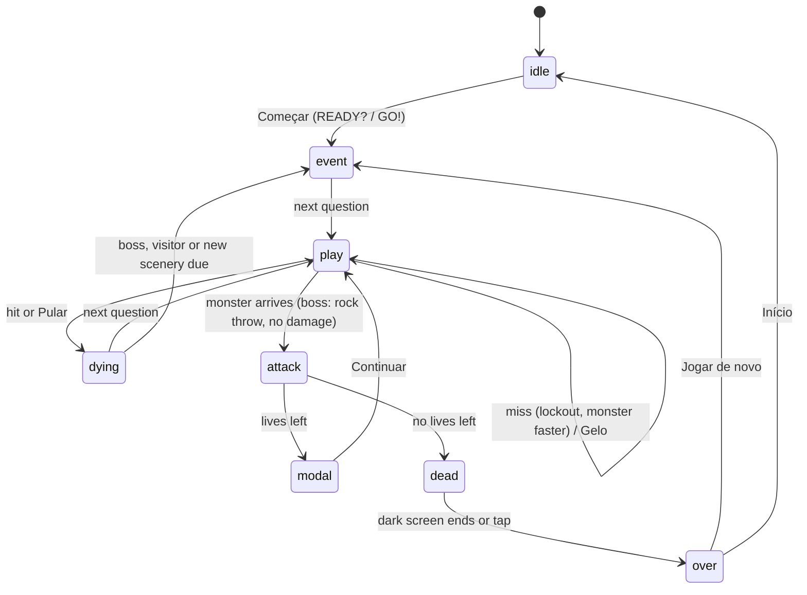

# Architecture

AWS Cloud Quest is a static page: one HTML file, one stylesheet and a set of classic scripts loaded in order. There is no build step, and nothing is fetched at runtime. Graphics are inline SVG, and sound is synthesized.

## Loading order

```
data/questions.js     → window.QUESTIONS
data/study-guide.js   → window.STUDY_GUIDE
js/config.js          → AwsCloudQuest.config       (pure)
js/questions.js       → AwsCloudQuest.questions    (pure)
js/topics.js          → AwsCloudQuest.topics       (pure)
js/rules.js           → AwsCloudQuest.rules        (pure)
js/storage.js         → AwsCloudQuest.storage      (pure, backend injected)
js/icons.js           → AwsCloudQuest.icons
js/sound.js           → AwsCloudQuest.sound
js/monsters.js        → AwsCloudQuest.monsters
js/hero.js            → AwsCloudQuest.hero
js/effects.js         → AwsCloudQuest.effects
js/ambient.js         → AwsCloudQuest.ambient
js/visitor.js         → AwsCloudQuest.visitor
js/net.js             → AwsCloudQuest.net          (encoders and parser are pure)
js/duel-rules.js      → AwsCloudQuest.duelRules    (pure)
js/pdf.js             → AwsCloudQuest.pdf          (pure)
js/report.js          → AwsCloudQuest.report       (builders are pure)
js/ui.js              → AwsCloudQuest.ui
js/game.js            → AwsCloudQuest.game
js/duel.js            → AwsCloudQuest.duel
js/main.js            → validates the bank, classifies topics, creates everything, wires input, boots
```

Each file is an IIFE that attaches its API to `window.AwsCloudQuest`. Pure files also set `module.exports`, so Node runs the same code in tests and CLI scripts.

## Modules

| Module | Responsibility | Does not touch |
|---|---|---|
| `questions` | Bank validation, normalization, deck building, option shuffling, `{w, r}` stats | DOM, storage, time |
| `topics` | Keyword classifier: question → study-guide topic | DOM |
| `rules` | Travel time, score, levels, fast hits, mode config, event schedule, boss rewards | DOM, storage |
| `storage` | localStorage keys and shapes; failures fall back to defaults | Game rules |
| `sound` | Web Audio effects, rain, heartbeat, music themes per scenery | Game state (it is told what to play) |
| `monsters` / `hero` | SVG art, attacks, boss looks, weapons, hero end states | Score, lives |
| `effects` | Short-lived DOM effects that remove themselves | Game state |
| `ambient` | Sceneries, day/night, weather, birds, critters | Game rules |
| `visitor` | The cheering visitor's walk, sign and timing | Game rules |
| `net` | Minimal MQTT 3.1.1 client over WebSocket; BroadcastChannel transport for tests | Game rules |
| `duelRules` | Room ids, names, round decisions, lives, draw, report outcomes | DOM, network |
| `duel` | Duel screens, room protocol, referee loop, shots, victory scene, duel report | Solo game state |
| `pdf` | PDF 1.4 writer: pages, text, wrapping, boxes, links | DOM |
| `report` | Areas analysis, Markdown and PDF reports, areas screen markup | Storage |
| `ui` | DOM, Portuguese text, focus, dialogs, power-up buttons | Rules (it shows what it receives) |
| `game` | State machine, main loop, timers, events, game log | DOM ids beyond what `main` passes in |
| `main` | Bootstrap, events, keyboard, sound unlock, export and share | Rules |

## State machine



| Phase | What happens |
|---|---|
| `idle` | Start screen. The ambience runs; nothing else moves. |
| `event` | A scripted moment: intro, boss announcement, visitor, boss defeated. Questions and power-ups are hidden. |
| `play` | The only phase that advances game time. Shots and power-ups are accepted. |
| `dying` | The monster dies with confetti (hit) or vanishes (skip). |
| `attack` | The monster's attack plays. Answers are locked. |
| `modal` | "Life lost" card with the answer and the explanation. |
| `dead` | Dark "GAME OVER" screen for `DEATH_SCREEN_MS`. |
| `over` | Game Over card. |

After each question, `questionDone()` decides what comes next, in this order: mystery box (if due), boss fight, visitor, next question. The scenery is checked when a question starts.

## Main loop

One `requestAnimationFrame` loop runs for the whole session:

1. `dt = min(now − lastFrame, MAX_DT_MS)`. A hidden tab or a slow frame cannot teleport the monster.
2. The field is measured every frame. Positions are computed in pixels from that, so rotation and resizing just work.
3. `ambient.update(dt)` runs in every phase.
4. Only in `play`: progress advances (`dt × speed / travel`), and the lockout, freeze and panel timers count down. The red vignette and the music intensity follow the progress.
5. The hero and monsters move with `transform` only.

All game timeouts go through `later()`, which tracks them so a new game or **Início** cancels everything at once.

## Travel time

```
chars  = length(question) + Σ length(options)
factor = max(MIN_FACTOR, 1 − LEVEL_SPEEDUP × (level − 1))
travel = (THINK_SECONDS + chars / READ_CHARS_PER_SEC) × factor
       + LONG_READ_BONUS if chars ≥ LONG_READ_CHARS
```

A short question (150 characters) takes 26 s at level 1. The longest one in the bank (1,245 characters) takes about 100 s. Each miss adds `WRONG_SPEEDUP` to the speed, up to `MAX_SPEED`.

## Events

| Event | When | Rule |
|---|---|---|
| Mystery box | Every `WEAPON_BOX_EVERY` (6–8) finished questions | `rules.nextBoxAt` |
| Boss fight | At `BOSS_FIRST` (12) hits, then every `BOSS_EVERY` (15) | `rules.isBossDue` |
| Visitor | First at `CHEER_FIRST` (5–7) hits, then at each `CHEERS` milestone | `rules.cheerMilestones` |
| Scenery | Every `SCENE_EVERY` (15) hits, cycling | `rules.sceneFor` |

**Boss fight.** The boss (one of four looks, never the same twice in a row) stands at the right. Each round is a normal question with a timer. A hit takes a heart. A miss or a timeout makes the boss throw a rock: the hero staggers, no life is lost, and the boss steps closer (`BOSS_STEP`, never past `BOSS_LIMIT`). After `BOSS_ROUNDS`, or when the hearts run out, `rules.bossReward` settles it. Winning gives `BOSS_BONUS` points and a life. Losing pays `BOSS_HIT_BONUS` per hit, then the boss crushes the hero for one life.

## Topics and performance by area

`data/study-guide.js` lists the four CLF-C02 domains and 18 topics. Each topic has keywords, study notes and AWS documentation links. On load, `main.js` gives every question without a valid `topic` the best match from `topics.classify()`. Matches in the answer weigh 3, in the question 2, in the explanation 1. Old saved reports get the same treatment.

`report.analyzeAreas(log, guide)` groups the game log by domain and topic and rates each one: Ótimo (≥ 80%), Bom (≥ 60%), Atenção (≥ 40%) or Precisa estudar. Strengths and weak areas come from those ratings. Weak areas carry their study notes and links.

## Reports

Every question shown is logged as `first`, `late`, `lost` or `skipped`, with the wrong options picked. At Game Over the report is saved under the same timestamp as the history row. The last `REPORTS_LIMIT` reports are kept.

- **PDF**: `report.toPdf()` draws the report with `pdf.createDocument()`: stat tiles, area bars, strengths, weak areas with links, an outcome bar and every question, with page footers. The result is a `Blob` URL that the player can view or download.
- **Markdown**: `report.toMarkdown()` builds the same content as text.
- **Compartilhar** uses the Web Share API, with a copy-link fallback.

## Sound

`sound.js` synthesizes everything with the Web Audio API. Music is a scheduler that queues beats 200 ms ahead, with a theme per scenery and a happy mood for the visitor. After a stall it skips missed beats instead of playing them all at once. The heartbeat starts when the monster passes `HEARTBEAT_FROM`.

Audio unlocks on the first `pointerup`, `touchend`, `click` or `keydown`. On iPhone the game sets `navigator.audioSession.type = "playback"` (Safari 17+), or plays a silent looping WAV on older versions, so sound works with the silent switch on.

## Layout

The page never scrolls. `body` is fixed to the visible viewport, and `.app` is a column: HUD, world (sky and field), answers. Long text scrolls inside the question panel, the answer list and dialog cards. Safe-area insets keep content clear of notches and the home indicator. A "▼ mais alternativas" hint appears when options are hidden below the answer list.

## Duel 1×1

The duel runs beside the solo game, which stays in its `idle` phase. `duel.js` takes over the field (the solo hero element, a mirrored rival, name tags), the question panel and the answers while a duel is on, and hands back with `game.goHome()`.

**Transport.** GitHub Pages is static, so the two browsers talk through a public MQTT broker over `wss://` (HiveMQ first, EMQX as fallback, both in `CONFIG.DUEL.BROKERS`). Each room is one topic, `awscloudquest/duel/v1/<room>`, where `<room>` is a random 12-character id that only exists in the shared link (`#duelo=<room>`). `net.js` implements CONNECT, SUBSCRIBE, PUBLISH (QoS 0), PINGREQ and DISCONNECT, and buffers WebSocket frames into packets. The broker echoes a client's own messages, so every message carries a `from` id and receivers drop their own.

**Referee.** The room creator (host) decides everything; the guest only displays results.

```
guest → join {name, hero, bank}            host → accept {to, name, hero, lives}  |  reject {to, reason}
both  → ready (after "Pronto!")            host → start {countdown}   (once both are ready, or both asked for a rematch)
host  → round {n, qid, order, seconds, lives, wins}
both  → answer {n, correct, ms}            host → result {n, result, lives, answers}
host  → over {winner}                      both → rematch | ping | bye
```

- `bank` is a hash of the question ids. Different game versions are rejected, so both players can look up every question.
- The host picks the question and the option order; both render the same screen.
- `ms` is measured on each player's own screen, from the moment the question appears. The host waits `GRACE_MS` after the first correct answer it receives, then `duelRules.decideRound` awards the round to the smallest `ms`. Network delay does not decide who was first.
- Round time uses `rules.travelSeconds` with a level that goes up every `LEVEL_EVERY` rounds. The host closes a round `TIMEOUT_GRACE_MS` after its time, so a lagging guest still gets the full time.
- `duelRules.applyResult` takes the lives down; `matchWinner` returns the winner, or `"draw"` when both reach zero in the same round.
- Each round opens with a "ROUND N" sign for `ROUND_INTRO_MS`; the timer starts when the question appears on each screen.
- The room creator picks 10 or 20 lives (`LIVES_OPTIONS`); `accept` and `start` carry the choice, and every `round` message carries the lives and round wins, so a player who missed a message is back in sync.

**Presence.** Both sides send `ping` every `HEARTBEAT_MS`. Leaving sends `bye`, and closing the page tries to. A player silent for `PEER_SILENT_MS` (15 s) pauses the match: both screens show who dropped and a countdown of `RECONNECT_MS` (2 minutes). A browser that loses the relay reconnects by itself every 3 seconds. When the dropped player is heard again, the host starts the interrupted round over. If the time runs out, the room closes. A waiting room with nobody joining expires after `ROOM_TTL_MS` (5 minutes). Closing a room clears every timer and disconnects from the broker. Nothing is stored on the broker (QoS 0, no retained messages), so an abandoned room leaves nothing behind.

**End of a match.** The winner's weapon is put away (`hero.celebrate`), they walk to a podium beside a flagpole and jump for `VICTORY_MS`. Then a curtain, like the solo GAME OVER, fades in "<NAME> VENCEU!" for `CURTAIN_MS`, and the end card shows a versus scoreboard with the matches each player won in the room. **Início** reuses the solo "Voltar ao início?" reminder to download the report.

**Report.** Each player logs their own rounds with the solo outcomes: `first` (answered right, even if slower), `lost` (wrong or out of time) and `skipped` (the rival won before they answered). The report adds `duel: {opponent, won, rounds, lives, score}`. `report.js` puts the result on top and relabels the outcomes for a duel. The history shows it with mode "Duelo".

## Stored in localStorage

| Key | Shape |
|---|---|
| `awsCloudQuestBest` | number |
| `awsCloudQuestHistory` | `[{ t, score, correct, level, mode }]`, newest first, at most `HISTORY_LIMIT` |
| `awsCloudQuestReports` | `[{ t, mode, hero, score, …, log }]`, at most `REPORTS_LIMIT` |
| `awsCloudQuestStats` | `{ [questionId]: { w, r } }` |
| `awsCloudQuestHero` | `"male"` or `"female"` |
| `awsCloudQuestMode` | `"easy"` or `"advanced"` |
| `awsCloudQuestMuted` | boolean |
| `awsCloudQuestName` | player name for duels |

Every access is wrapped in `try/catch`. With storage blocked, the game plays normally and remembers nothing. **Limpar** removes the history, reports and best score, and keeps the review stats.

## Testing

- **Unit tests** (`tests/*.test.js`, `node:test`): bank rules, deck building, travel time, score, modes, event schedule, boss rewards, storage, topics, areas analysis, Markdown, the PDF writer, the bank itself and the SEO tags.
- **Smoke test** (`scripts/smoke.mjs`, Playwright with a fake clock, Chromium and WebKit): start flow, setup dialog, intro, sound hint, misses and lockout, hits, lives, Game Over, history, reports, every monster attack, power-ups, mystery box, visitor, boss win and loss, scenery change and ambience. It fails on any console error.
- **Duel smoke test** (`scripts/duel-smoke.mjs`, Chromium and WebKit): two pages of one browser play a full duel over the BroadcastChannel transport, with shortened timings set through `window.AwsCloudQuestDuelTest`. It covers the room link, joining, the shared question and option order, a hit, a lock after a miss, both wrong, the victory, both reports, a rematch and leaving. `--mqtt` runs the same test through the public broker.
- **Layout test** (`scripts/responsive.mjs`): 10 viewports, from 320 × 480 to 1920 × 969, including landscape and Safari's reduced height. It checks that nothing overflows sideways, the HUD and answers stay on screen, and every dialog's buttons are reachable.
